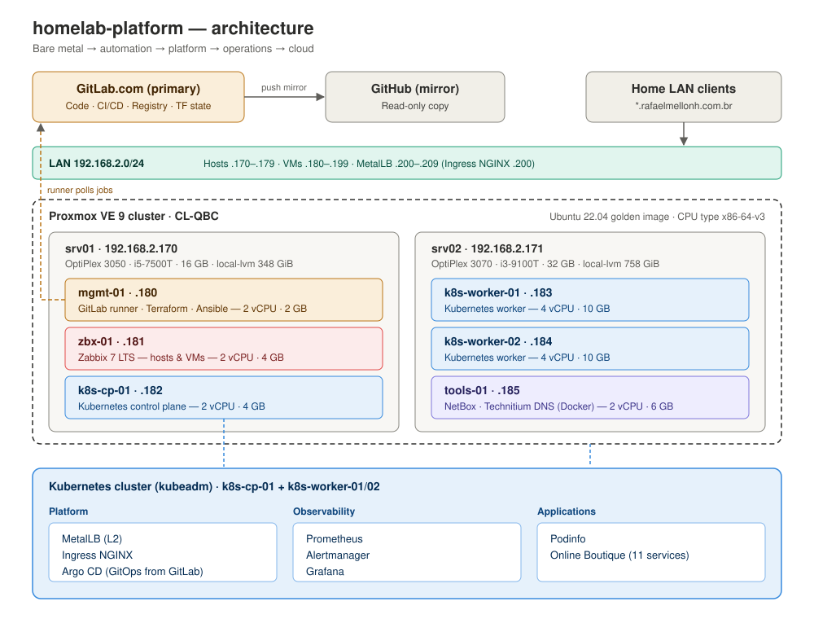

# homelab-platform

> From bare metal to a fully automated, observable platform — and then to the cloud — all as code.


## Where the project lives

| | Repository | Content |
|---|---|---|
| **Primary** | [GitLab](https://gitlab.com/rmellonh/homelab-platform) | Code, CI/CD pipelines, merge requests, issues and registry |
| **Mirror** | [GitHub](https://github.com/rafamellonh/homelab-platform) | Automatic copy of the code and documentation (read-only) |

Development happens on GitLab. Every push is automatically replicated to GitHub through a *push mirror*.
To see pipelines running, open issues or follow merge requests, visit GitLab.
All documentation, including the issues found and how they were solved, lives in the repository itself and is available on both.

---

## About

This project documents, step by step, the build of a complete platform on two mini PCs at home:
starting from a bare-metal Proxmox install, through infrastructure as code, configuration management,
Kubernetes, CI/CD, GitOps and observability — delivering and operating real applications —
and finally migrating the workloads to a public cloud using the same code.

The goal is to apply and demonstrate SRE/DevOps skills on real infrastructure, not in a sandbox.

**Journey:** bare metal → automation → platform → operations → cloud

## Motivation

I have experience with most of the tools in this project, but my current job doesn't put me
in daily contact with all of them. This project is how I keep them in practice and up to date
while developing the skills I don't yet use day to day.

| Goal | Areas |
|---|---|
| **Practice and stay current** | Linux, virtualization (Proxmox), Ansible, Terraform, Kubernetes, Zabbix, cloud |
| **Learn and develop** | CI/CD, GitOps (Argo CD), cloud-native observability (Prometheus and Grafana), SRE practices |

That's why the documentation records not only what worked, but also the mistakes, the questions
and the decisions made along the way.

## Architecture



## Tech stack

| Layer | Tools |
|---|---|
| Virtualization | Proxmox VE 9 |
| Operating system | Ubuntu 22.04 LTS (cloud-init golden image) |
| Provisioning | Terraform (`bpg/proxmox`) |
| Configuration | Ansible |
| Containers & orchestration | Kubernetes (kubeadm), containerd |
| Repository & CI/CD | GitLab.com + GitLab CI (local runner), mirrored to GitHub |
| Registry | GitLab Container Registry |
| GitOps | Argo CD, Kustomize |
| Monitoring | Zabbix 7 LTS, Prometheus, Alertmanager, Grafana |
| Documentation & IPAM | NetBox (Docker) |
| DNS | Technitium DNS Server (Docker) — zone `rafaelmellonh.com.br` |
| Applications | Podinfo, Online Boutique |
| Cloud | AWS or Azure (to be decided) |

## Hardware

| Host | Model | IP | CPU | RAM | VM storage (`local-lvm`) |
|---|---|---|---|---|---|
| `srv01` | Dell OptiPlex 3050 Micro | 192.168.2.170 | Intel i5-7500T (4C/4T) | 16 GB | ~348 GiB |
| `srv02` | Dell OptiPlex 3070 Micro | 192.168.2.171 | Intel i3-9100T (4C/4T) | 32 GB | ~758 GiB |

## Network

Network `192.168.2.0/24`, DNS domain `rafaelmellonh.com.br` served by Technitium on `tools-01`.

| Range | Use |
|---|---|
| .170 – .179 | Physical hosts |
| .180 – .199 | Virtual machines |
| .200 – .209 | MetalLB pool (Ingress NGINX on .200, `*.apps.rafaelmellonh.com.br`) |

| VM | Node | IP | vCPU | RAM | Disk | Role |
|---|---|---|---|---|---|---|
| mgmt-01 | srv01 | .180 | 2 | 2 GB | 30 GB | GitLab runner, Terraform, Ansible |
| zbx-01 | srv01 | .181 | 2 | 4 GB | 50 GB | Zabbix |
| k8s-cp-01 | srv01 | .182 | 2 | 4 GB | 40 GB | Kubernetes control plane |
| k8s-worker-01 | srv02 | .183 | 4 | 10 GB | 100 GB | Kubernetes worker |
| k8s-worker-02 | srv02 | .184 | 4 | 10 GB | 100 GB | Kubernetes worker |
| tools-01 | srv02 | .185 | 2 | 6 GB | 50 GB | Internal tools (NetBox, Technitium DNS) |

VMs use CPU type `x86-64-v3`, since the two nodes have different CPU generations.

## Applications

- **[Podinfo](https://github.com/stefanprodan/podinfo)** — used to demonstrate the full delivery path:
  build, security scan, push to the registry and GitOps deployment.
- **[Online Boutique](https://github.com/GoogleCloudPlatform/microservices-demo)** — an 11-microservice application
  with a built-in load generator, used for operations, monitoring and failure scenarios.

## Roadmap

| # | Phase | Status | Docs |
|---|---|---|---|
| 0 | Planning | ✅ | [00-planning](docs/phases/00-planning.md) |
| 1 | Proxmox installation & cluster | ⏳ | [01-proxmox](docs/phases/01-proxmox.md) |
| 2 | Golden image | ⏳ | [02-golden-image](docs/phases/02-golden-image.md) |
| 3 | First VM (manual) | ⏳ | [03-first-vm](docs/phases/03-first-vm.md) |
| 4 | Provisioning with Terraform | ⏳ | [04-terraform](docs/phases/04-terraform.md) |
| 5 | Configuration with Ansible | ⏳ | [05-ansible](docs/phases/05-ansible.md) |
| 6 | Infrastructure monitoring (Zabbix) | ⏳ | [06-zabbix](docs/phases/06-zabbix.md) |
| 7 | Kubernetes | ⏳ | [07-kubernetes](docs/phases/07-kubernetes.md) |
| 8 | CI/CD | ⏳ | [08-cicd](docs/phases/08-cicd.md) |
| 9 | GitOps | ⏳ | [09-gitops](docs/phases/09-gitops.md) |
| 10 | Observability | ⏳ | [10-observability](docs/phases/10-observability.md) |
| 11 | Online Boutique | ⏳ | [11-application](docs/phases/11-application.md) |
| 12 | SRE: SLOs & failure scenarios | ⏳ | [12-sre-scenarios](docs/phases/12-sre-scenarios.md) |
| 13 | Rebuild from scratch | ⏳ | [13-rebuild](docs/phases/13-rebuild.md) |
| 14 | Cloud foundation | ⏳ | [14-cloud-foundation](docs/phases/14-cloud-foundation.md) |
| 15 | Lift-and-shift | ⏳ | [15-lift-and-shift](docs/phases/15-lift-and-shift.md) |
| 16 | Managed Kubernetes | ⏳ | [16-managed-k8s](docs/phases/16-managed-k8s.md) |
| 17 | Hybrid & cutover | ⏳ | [17-cutover](docs/phases/17-cutover.md) |
| 18 | Cost report & teardown | ⏳ | [18-cost-and-teardown](docs/phases/18-cost-and-teardown.md) |

✅ Done · 🚧 In progress · ⏳ Planned

## Repository structure

```
homelab-platform/
├── README.md
├── .gitlab-ci.yml       # CI/CD pipeline (must stay at the root for GitLab)
├── docs/
│   ├── images/          # diagrams, screenshots and badges
│   ├── phases/          # one document per phase (00-planning.md, 01-proxmox.md, ...)
│   ├── adr/             # architecture decision records
│   └── postmortems/     # incident reports from failure scenarios
├── scripts/             # golden image creation
├── terraform/           # VM provisioning (lab and cloud environments)
├── ansible/             # configuration management (roles and playbooks)
└── kubernetes/          # GitOps manifests managed by Argo CD (Kustomize)
```

## Documentation

Every phase is documented in [docs/phases](docs/phases) with the same structure:

1. Goal
2. Prerequisites
3. Step by step
4. Validation
5. Issues found and how they were solved
6. Future improvements

- **Issues and solutions (summary of all phases):** [docs/phases/troubleshooting.md](docs/phases/troubleshooting.md)
- **Architecture decisions:** [docs/adr](docs/adr)
- **Postmortems:** [docs/postmortems](docs/postmortems)

## Principles

- **Everything as code** — infrastructure, configuration and deployments are versioned in Git.
- **Reproducible** — the whole platform can be destroyed and rebuilt from this repository.
- **Portable** — generic Terraform modules, provider-agnostic Ansible roles and Kustomize overlays,
  so the same code can move to the cloud.
- **Secure by default** — no secrets in the repository; protected GitLab variables and Ansible Vault;
  fork pipelines don't use the local runner; deployments only from `main`, with manual approval.
- **Observable** — from the physical host temperature to application latency.
- **Transparent** — mistakes, questions and decisions are recorded in the documentation, not just the final result.

## Known limitations

- Local storage on each Proxmox node (one golden image template per node). Shared storage is planned.
- Two-node Proxmox cluster: if one node goes down, the other loses quorum (a QDevice is planned).
- Single control plane node (no Kubernetes high availability).
- Single DNS server (`tools-01`); clients keep the router as secondary DNS.
- Split-horizon DNS: public records of `rafaelmellonh.com.br` must be mirrored in Technitium to resolve inside the LAN.
- Not exposed to the internet.

## Author

**Rafael** — Systems / Infrastructure Administrator on the path to SRE/DevOps.

[LinkedIn](https://www.linkedin.com/in/<user>) · [GitLab](https://gitlab.com/rmellonh) · [GitHub](https://github.com/rafamellonh)
