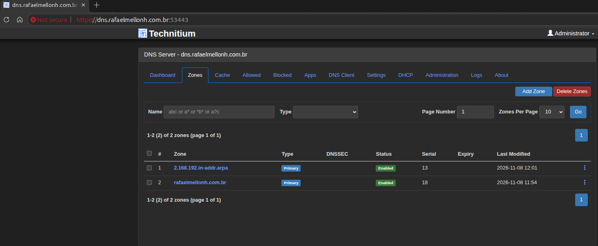
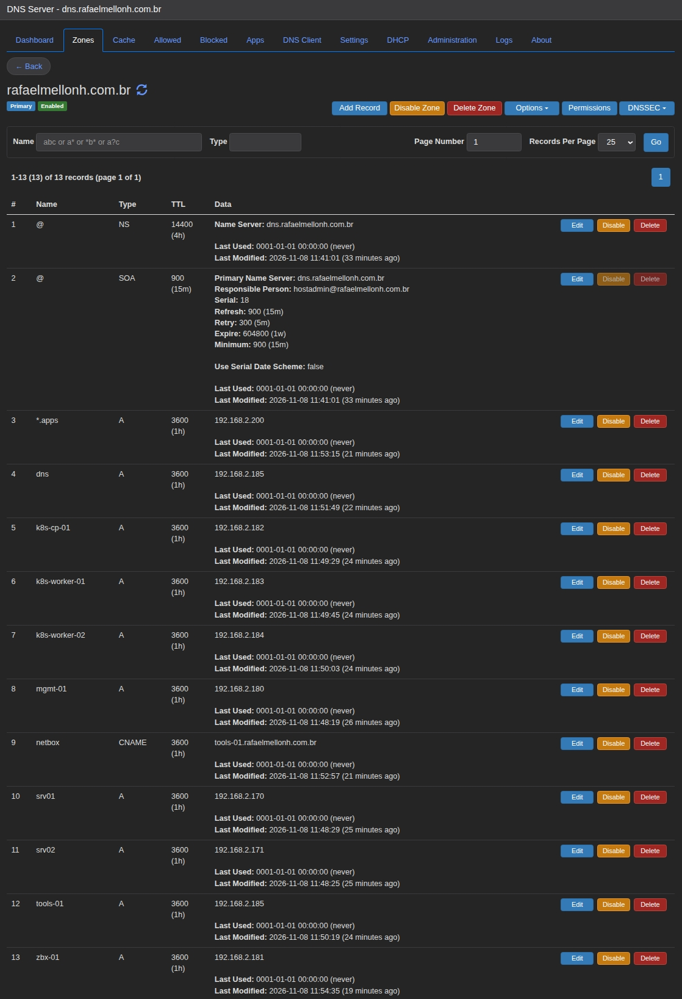
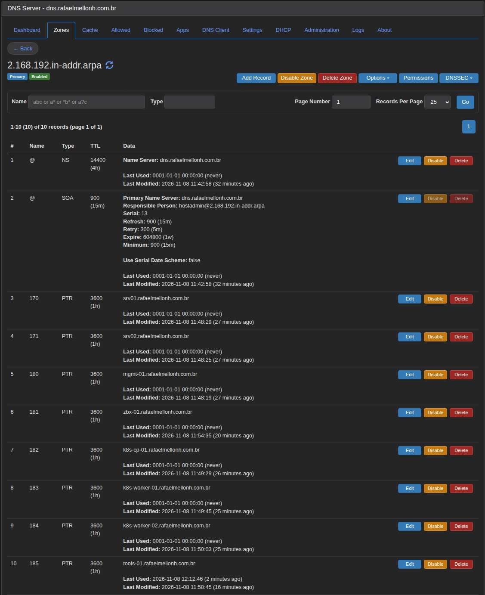
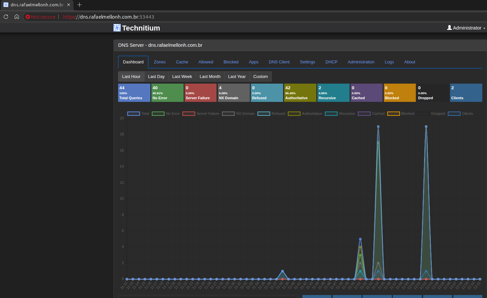
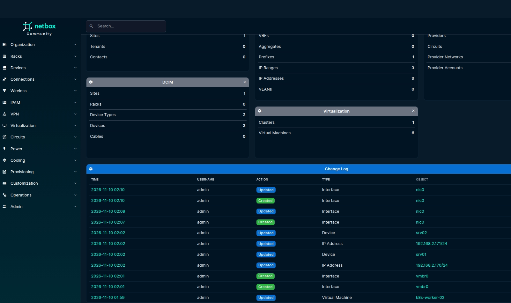
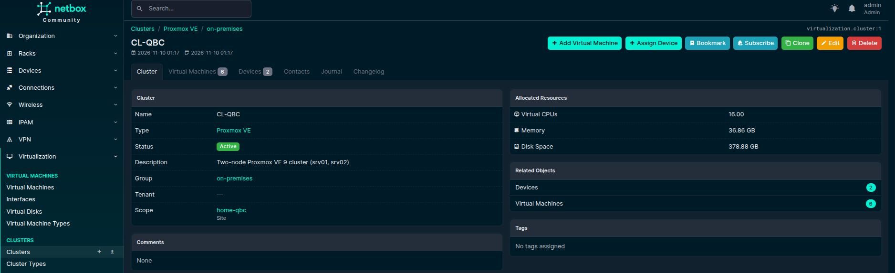
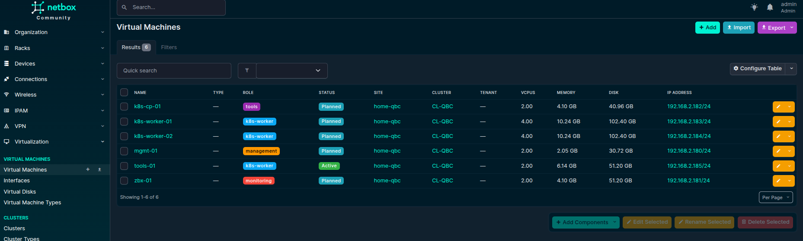
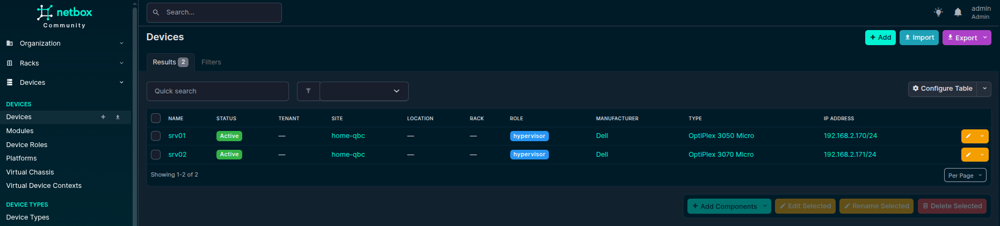
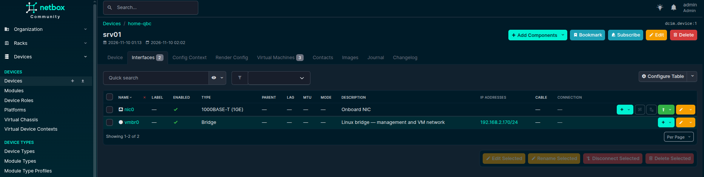
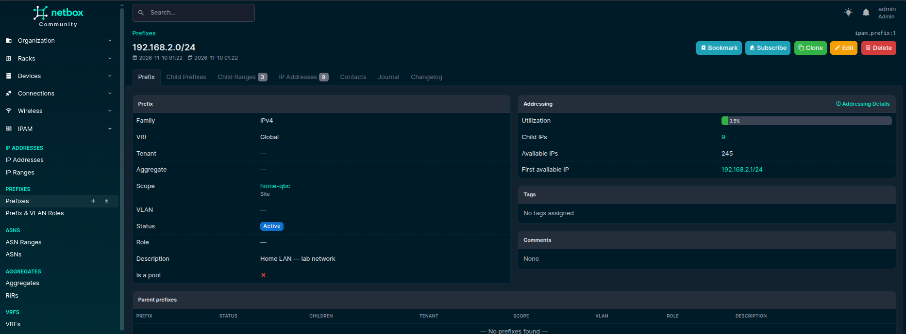

# Phase 3 — First VM (manual)

## 1. Goal

Create the first VM of the project by hand, from the golden image, and bring up the internal tools that every
later phase depends on:

- **Technitium DNS Server**: authoritative DNS for `rafaelmellonh.com.br` and the reverse zone of the lab network
- **NetBox**: inventory and IPAM, the future source of truth for Terraform and Ansible

Then point the Proxmox nodes, the templates and the VM itself to the new DNS server.

`tools-01` was chosen as the first VM because DNS and NetBox must exist before Terraform (Phase 4) and the
Kubernetes cluster (Phase 7). Building it manually also shows every step that Terraform and Ansible will automate later.

## 2. Prerequisites

- [Phase 2](02-golden-image.md) completed (template `tpl-ubuntu-2404-srv02`, VMID 9001, on srv02)
- IP `192.168.2.185` free (see [Phase 0](00-planning.md))
- SSH key of the admin workstation already injected by the template

### References

| Topic | Link |
|---|---|
| Docker Engine on Ubuntu (convenience script) | https://docs.docker.com/engine/install/ubuntu/#install-using-the-convenience-script |
| Convenience script source | https://github.com/docker/docker-install |
| Technitium DNS Server | https://technitium.com/dns/ |
| Technitium Docker environment variables | https://github.com/TechnitiumSoftware/DnsServer/blob/master/DockerEnvironmentVariables.md |
| netbox-docker | https://github.com/netbox-community/netbox-docker |
| NetBox documentation | https://netboxlabs.com/docs/netbox/ |
| Caddy `tls` directive | https://caddyserver.com/docs/caddyfile/directives/tls |

## 3. Step by step

### 3.1 Clone the template (srv02)

```bash
qm clone 9001 185 --name tools-01 --full
qm set 185 --cores 2 --memory 6144 \
  --ipconfig0 ip=192.168.2.185/24,gw=192.168.2.1 \
  --nameserver 192.168.2.1 --tags tools,docker
qm resize 185 scsi0 50G
qm start 185
```

- The VMID matches the last octet of the IP.
- The nameserver is temporary: Technitium does not exist yet (changed in section 3.6).
- The template disk has no LVM, so cloud-init grows `/` to 50 GB on first boot (see Phase 2, section 3.3).

```bash
ssh rafael@192.168.2.185 'hostname; df -h /; cloud-init status; systemctl is-active qemu-guest-agent'
```

> Log in as `rafael`. cloud-init disables root login over SSH (`Please login as the user "rafael" rather than the user "root"`).
> The user has no password: access is by SSH key only, and `sudo` works without a password.

### 3.2 Free port 53 (before installing Docker)

`systemd-resolved` listens on `127.0.0.53:53`, which conflicts with Technitium.

Edit `/etc/systemd/resolved.conf` and set:

```ini
DNSStubListener=no
```

Point `/etc/resolv.conf` to the real resolver list, otherwise the VM loses name resolution:

```bash
sudo ln -sf /run/systemd/resolve/resolv.conf /etc/resolv.conf
sudo systemctl restart systemd-resolved
sudo ss -lntup | grep ':53 '          # no output expected
grep nameserver /etc/resolv.conf
```

> Do this **before** installing Docker. See [Issues found](#5-issues-found-and-how-they-were-solved).

### 3.3 Docker Engine

Installed with Docker's official convenience script, for speed in this manual phase.
The Ansible role in Phase 5 will use the apt repository method, which is idempotent and
allows pinning versions.

```bash
curl -fsSL https://get.docker.com -o get-docker.sh
sh get-docker.sh --dry-run
sudo sh get-docker.sh
rm get-docker.sh
```

| `curl` flag | Purpose |
|---|---|
| `-f` | Fail on HTTP errors instead of saving the error page |
| `-s` / `-S` | Silent, but still show errors |
| `-L` | Follow redirects |

Log rotation (the default `json-file` driver grows without limit):

`/etc/docker/daemon.json`:

```json
{
  "log-driver": "json-file",
  "log-opts": { "max-size": "10m", "max-file": "3" }
}
```

```bash
sudo systemctl restart docker
sudo usermod -aG docker rafael     # log out and in again
```

> Membership in the `docker` group is equivalent to root on the host. Acceptable for the lab.

```bash
docker version --format '{{.Server.Version}}'
docker compose version
docker info --format '{{.LoggingDriver}} {{.CgroupDriver}} {{.CgroupVersion}}'
docker run --rm hello-world
```

### 3.4 Technitium DNS Server

All files live in `/data/technitium`:

```
/data/technitium/
├── .env            # admin password (chmod 600, never committed)
├── compose.yaml
└── data/           # bind mount → /etc/dns (configuration and zones)
```

`.env`:

```
DNS_ADMIN_PASSWORD=<password>
```

`compose.yaml`:

```yaml
# Environment variables: https://github.com/TechnitiumSoftware/DnsServer/blob/master/DockerEnvironmentVariables.md
services:
  dns:
    image: technitium/dns-server:latest
    container_name: technitium
    hostname: dns
    restart: unless-stopped
    ports:
      - "53:53/udp"
      - "53:53/tcp"
      - "5380:5380/tcp"
      - "53443:53443/tcp"
    environment:
      DNS_SERVER_DOMAIN: dns.rafaelmellonh.com.br
      DNS_SERVER_ADMIN_PASSWORD: ${DNS_ADMIN_PASSWORD}
      DNS_SERVER_RECURSION: AllowOnlyForPrivateNetworks
      DNS_SERVER_FORWARDERS: 1.1.1.1, 8.8.8.8
    volumes:
      - ./data:/etc/dns
    sysctls:
      - net.ipv4.ip_local_port_range=1024 65000
```

```bash
cd /data/technitium
sudo chmod 600 .env
sudo docker compose config
sudo docker compose up -d
sudo docker compose logs --tail 20
dig +short @127.0.0.1 ubuntu.com
```

Version deployed: **Technitium DNS Server v15.6.2**.

> The environment variables are read **only on the first start**, when `dns.config` does not exist yet.
> Later changes must be made in the web console, or by removing `./data` and starting over.

#### Zones

Created in the web console (`http://192.168.2.185:5380`, user `admin`) under *Zones → Add Zone*, both as **Primary Zone**:

- `rafaelmellonh.com.br`
- `2.168.192.in-addr.arpa`



#### Records

All records are created in the **forward** zone. For each host A record, the option
**Add reverse (PTR) record** creates the PTR in the reverse zone automatically.


| Name | Type | Value | Add reverse (PTR) |
|---|---|---|---|
| `srv01` | A | 192.168.2.170 | ✅ |
| `srv02` | A | 192.168.2.171 | ✅ |
| `mgmt-01` | A | 192.168.2.180 | ✅ |
| `zbx-01` | A | 192.168.2.181 | ✅ |
| `k8s-cp-01` | A | 192.168.2.182 | ✅ |
| `k8s-worker-01` | A | 192.168.2.183 | ✅ |
| `k8s-worker-02` | A | 192.168.2.184 | ✅ |
| `tools-01` | A | 192.168.2.185 | ✅ |
| `dns` | A | 192.168.2.185 | ❌ |
| `netbox` | CNAME | tools-01.rafaelmellonh.com.br | — |
| `*.apps` | A | 192.168.2.200 | ❌ |

- `dns` is an **A** record, not a CNAME, because it is the target of the zone's NS record (RFC 2181).
- An IP has a single PTR, pointing to the machine's own name (`185 → tools-01`). Service aliases (`dns`, `netbox`) only exist in the forward zone.
- `*.apps` is a pattern, not a host, so it has no PTR.





#### HTTPS for the web console

1. Publish port `53443` in `compose.yaml` (already in the file above) and run `sudo docker compose up -d`.
2. *Settings → Web Service → HTTPS Options*:

| Option | Value |
|---|---|
| Enable HTTPS | ✅ |
| Enable HTTP/3 | ❌ (requires `libmsquic`) |
| Enable HTTP to HTTPS Redirection | optional |
| Use A Self Signed TLS Certificate When TLS Certificate File Path Is Unspecified | ✅ |
| Web Service HTTPS Port | 53443 |


> With Docker in bridge mode, ports and local addresses must **only** be changed in `compose.yaml`.
> Changing them in *Settings* makes the console unreachable.

The console is available at `https://dns.rafaelmellonh.com.br:53443`. The browser shows *Not secure* because the
certificate is self-signed.



### 3.5 NetBox

Deployed with [netbox-docker](https://github.com/netbox-community/netbox-docker) (branch `release`) in `/data/netbox`,
behind a Caddy reverse proxy for HTTPS:

```
browser ──HTTPS:443──> Caddy (tls internal) ──HTTP:8080──> netbox
```

```bash
cd /data
sudo git clone -b release https://github.com/netbox-community/netbox-docker.git netbox
cd /data/netbox
```

| File | Role |
|---|---|
| `docker-compose.yml` | Project file, **never edited** (keeps `git pull` clean on upgrades) |
| `docker-compose.override.yml` | Local changes, merged automatically by `docker compose` |
| `docker-compose.test*.yml` | Project tests, not used |

#### Secrets

The files in `env/` ship with **example values that are the same for every installation**. All of them were replaced:

| Secret | Files where it must match |
|---|---|
| DB password | `netbox.env` (`DB_PASSWORD`) + `postgres.env` (`POSTGRES_PASSWORD`) |
| Redis password | `netbox.env` (`REDIS_PASSWORD`) + `redis.env` |
| Redis cache password | `netbox.env` (`REDIS_CACHE_PASSWORD`) + `redis-cache.env` |
| `SECRET_KEY` | `netbox.env` (min. 50 characters) |
| `API_TOKEN_PEPPER_1` | `netbox.env` (min. 50 characters) |

```bash
openssl rand -hex 32   # SECRET_KEY, API_TOKEN_PEPPER_1
openssl rand -hex 16   # passwords
sudo chmod 600 env/*.env
```

Hex values avoid special characters that could break the `.env` files.

Origin trusted for login over HTTPS (`env/netbox.env`):

```
CSRF_TRUSTED_ORIGINS=https://netbox.rafaelmellonh.com.br
```

#### Reverse proxy

`Caddyfile`:

```
netbox.rafaelmellonh.com.br {
    tls internal
    reverse_proxy netbox:8080
}
```

`docker-compose.override.yml`:

```yaml
services:
  netbox:
    restart: unless-stopped
    healthcheck:
      start_period: 300s
  netbox-worker:
    restart: unless-stopped
  postgres:
    restart: unless-stopped
  redis:
    restart: unless-stopped
  redis-cache:
    restart: unless-stopped

  tls-proxy:
    image: caddy:2-alpine
    restart: unless-stopped
    depends_on:
      - netbox
    ports:
      - "80:80"
      - "443:443"
    volumes:
      - ./Caddyfile:/etc/caddy/Caddyfile:ro
      - caddy-data:/data

volumes:
  caddy-data:
```

- `restart: unless-stopped` on every service: the netbox-docker compose file sets no restart policy,
  so without it the NetBox containers do not come back after a reboot.
- `tls internal`: Caddy creates a local CA and issues and renews the certificate by itself.
- Port 80 only redirects to HTTPS.
- NetBox's own port is not published: it is reachable only through the proxy, and only by name
  (`https://192.168.2.185` does not match the `Caddyfile`).

```bash
sudo docker compose config > /dev/null && echo "YAML OK"
sudo docker compose pull
sudo docker compose up -d
sudo docker compose ps
sudo docker compose exec netbox /opt/netbox/netbox/manage.py createsuperuser
```

Versions deployed (pinned by netbox-docker):

| Component | Image |
|---|---|
| NetBox | `netboxcommunity/netbox:v4.7-5.1.1` (NetBox v4.7.4) |
| PostgreSQL | `postgres:18-alpine` |
| Redis | `valkey/valkey:9.1-alpine` |
| Reverse proxy | `caddy:2-alpine` |

The interface language is set to English (*Preferences → Language*), to match the documentation.



#### Data model

Every object was entered by hand, on purpose, to learn the model. Objects are created in dependency order:
each one references the previous ones.

| # | Menu | Objects |
|---|---|---|
| 1 | Organization → Regions | `Canada` → `Quebec` |
| 2 | Organization → Site Groups | `on-premises` |
| 3 | Organization → Sites | `home-qbc` (region `Quebec`, group `on-premises`, time zone `America/Toronto`) |
| 4 | Devices → Manufacturers | `Dell` |
| 5 | Devices → Device Types | `OptiPlex 3050 Micro`, `OptiPlex 3070 Micro` (height 0U: not rack-mounted) |
| 6 | Devices → Device Roles | `hypervisor`, `management`, `monitoring`, `k8s-control-plane`, `k8s-worker`, `tools` |
| 7 | Devices → Platforms | `Proxmox VE 9` (hosts), `Ubuntu 24.04 LTS` (VMs) |
| 8 | Devices → Devices | `srv01`, `srv02` |
| 9 | Virtualization → Cluster Types / Cluster Groups | `Proxmox VE` / `on-premises` |
| 10 | Virtualization → Clusters | `CL-QBC` (scope: site `home-qbc`), with `srv01` and `srv02` assigned |
| 11 | IPAM → Prefixes / IP Ranges | `192.168.2.0/24`; hosts `.170–.179`, VMs `.180–.199`, MetalLB `.200–.209` (reserved) |
| 12 | Virtualization → Virtual Machines | the 6 VMs of Phase 0, each pinned to its host (*Device*) |
| 13 | Interfaces (*Add Components → Interfaces*) | hosts: `nic0` (1000BASE-T, bridge `vmbr0`) and `vmbr0` (Bridge); VMs: `eth0` |
| 14 | IPAM → IP Addresses | the lab IPs with DNS names, assigned to `vmbr0` / `eth0` and set as primary IP |

- **Regions and groups** are optional, but they prepare the inventory for the cloud phases (Phase 14+),
  where each cloud region becomes a site.
- **Platform** is the operating system of the object: Proxmox VE on the hosts, Ubuntu inside the VMs.
  The hypervisor of a VM is already known from its cluster and host.
- **VM status:** `tools-01` is `Active` (with *Start on boot*); the others are `Planned` until Terraform creates them.
- **Resources:** memory and disk are entered in MB (e.g. 10240 MB RAM, 102400 MB disk for a worker).
- **Interfaces** follow the real configuration: on the hosts the IP is on the bridge `vmbr0`, whose port is the
  physical `nic0` (Phase 1, section 3.2); on the VMs cloud-init names the NIC `eth0` (Phase 2).
- `192.168.2.200` (Ingress) is a service IP, so it stays unassigned.











### 3.6 Point the lab to Technitium

| Where | How | Value |
|---|---|---|
| Proxmox nodes (`srv01`, `srv02`) | Web UI: *Node → System → DNS → Edit* (per node, not per cluster) | search `rafaelmellonh.com.br`, DNS 1 `192.168.2.185`, DNS 2 `8.8.8.8` |
| Templates 9000 (srv01) and 9001 (srv02) | `qm set <vmid> --nameserver "192.168.2.185 8.8.8.8"` | used by every future clone |
| `tools-01` | `qm set 185 --nameserver "192.168.2.185 8.8.8.8"` then `qm reboot 185` | applied by cloud-init |
| Admin workstation | network settings of the OS | DNS 1 `192.168.2.185`, DNS 2 `8.8.8.8` |

```bash
qm config 9000 | grep -E 'nameserver|searchdomain'   # srv01
qm config 9001 | grep -E 'nameserver|searchdomain'   # srv02
```

```
nameserver: 192.168.2.185 8.8.8.8
searchdomain: rafaelmellonh.com.br
```

The templates are never started, so no reboot is needed: only the clones use the setting.

> **Secondary DNS:** Phase 0 planned the router as secondary. `8.8.8.8` was used instead: if Technitium is down,
> neither resolves the internal names, and a public resolver does not depend on the router.

> Changing a cloud-init option makes Proxmox present the VM as a new instance. On the next boot cloud-init runs
> again, rewrites the netplan file **and regenerates the SSH host keys**, so the workstation shows a new host key
> (see [Issues found](#5-issues-found-and-how-they-were-solved)).

## 4. Validation

### DNS server

From any host of the LAN:

```bash
for h in srv01 srv02 mgmt-01 zbx-01 k8s-cp-01 k8s-worker-01 k8s-worker-02 tools-01 dns netbox grafana.apps; do
  printf '%-15s %s\n' "$h" "$(dig +short @192.168.2.185 $h.rafaelmellonh.com.br | tr '\n' ' ')"
done
for i in 170 171 180 181 182 183 184 185; do
  printf '%-15s %s\n' "$i" "$(dig +short @192.168.2.185 -x 192.168.2.$i | tr '\n' ' ')"
done
```

```
srv01           192.168.2.170
srv02           192.168.2.171
mgmt-01         192.168.2.180
zbx-01          192.168.2.181
k8s-cp-01       192.168.2.182
k8s-worker-01   192.168.2.183
k8s-worker-02   192.168.2.184
tools-01        192.168.2.185
dns             192.168.2.185
netbox          tools-01.rafaelmellonh.com.br. 192.168.2.185
grafana.apps    192.168.2.200
170             srv01.rafaelmellonh.com.br.
171             srv02.rafaelmellonh.com.br.
180             mgmt-01.rafaelmellonh.com.br.
181             zbx-01.rafaelmellonh.com.br.
182             k8s-cp-01.rafaelmellonh.com.br.
183             k8s-worker-01.rafaelmellonh.com.br.
184             k8s-worker-02.rafaelmellonh.com.br.
185             tools-01.rafaelmellonh.com.br.
```

### DNS clients

On each node and on `tools-01` (short name, internal CNAME, external name):

```bash
getent hosts tools-01
getent hosts netbox.rafaelmellonh.com.br
getent hosts ubuntu.com
```

```
192.168.2.185   tools-01.rafaelmellonh.com.br
192.168.2.185   tools-01.rafaelmellonh.com.br netbox.rafaelmellonh.com.br
2620:2d:4000:1::27 ubuntu.com
```

*(srv02; `getent hosts` prefers IPv6 addresses when they exist)*

### Containers

```bash
sudo docker compose -f /data/technitium/compose.yaml ps
cd /data/netbox && sudo docker compose ps
```

### NetBox inventory

| Object | Count |
|---|---|
| Sites | 1 |
| Device types | 2 |
| Devices | 2 |
| Clusters | 1 |
| Virtual machines | 6 |
| Prefixes | 1 |
| IP ranges | 3 |
| IP addresses | 9 |

### Summary

| Check | Expected | Result |
|---|---|---|
| `/` grown by cloud-init | ~50 GB | ✅ |
| Port 53 free before Technitium | no listener | ✅ |
| Docker | `hello-world` OK, `json-file` with rotation | ✅ |
| Technitium | `Up`, forwarders resolve external names | ✅ |
| A, CNAME and wildcard records | all names resolve | ✅ |
| PTR records | one name per IP | ✅ |
| Technitium console over HTTPS | `https://dns.rafaelmellonh.com.br:53443` | ✅ |
| NetBox containers | all `healthy` | ✅ |
| All 7 containers back after a reboot | `Up` with policy `unless-stopped` | ✅ |
| NetBox over HTTPS | `https://netbox.rafaelmellonh.com.br` | ✅ |
| NetBox inventory | counts above, primary IP on every host and VM | ✅ |
| Nodes, templates and `tools-01` use Technitium | `nameserver 192.168.2.185` first | ✅ |

## 5. Issues found and how they were solved

### Docker kept using the old stub resolver

**Symptom:** `docker compose up` failed to pull the image:
`lookup registry-1.docker.io on 127.0.0.53:53: ... connection refused`.

**Cause:** the Docker daemon had read the old `/etc/resolv.conf` (stub `127.0.0.53`) when it started,
before the stub listener was disabled.

**Solution:** `sudo systemctl restart docker`. Disabling the stub listener before installing Docker avoids it.

### Records created as PTR in the wrong zone

**Symptom:** records like `srv01 PTR 192.168.2.170` in the forward zone, and `srv01` as a name in the reverse zone.

**Cause:** the record type stayed on PTR from a previous attempt, and the name/value of a PTR were inverted
(a PTR name is the last octet, its value is the FQDN).

**Solution:** deleted them and created only **A** records in the forward zone, with *Add reverse (PTR) record* checked.

### Wrong PTR for `.185` and an invalid PTR for `.200`

**Symptom:** `dig -x 192.168.2.185` returned `dns.rafaelmellonh.com.br`, and the reverse zone had
`200 PTR *.apps.rafaelmellonh.com.br`.

**Cause:** *Add reverse (PTR) record* was left checked when creating the `dns` and `*.apps` records.

**Solution:** edited `185` to point to `tools-01` and deleted `200`. Only one PTR per IP, and never for a wildcard.

### Console not reachable over HTTPS

**Symptom:** `https://...:5380` did not open; after publishing port 53443,
`curl -kI https://127.0.0.1:53443/` returned `SSL_ERROR_SYSCALL`.

**Cause:** port 5380 is HTTP only, and HTTPS was not enabled in the console (the Docker proxy accepted the
connection, but nothing listened inside the container). HTTPS only starts when a certificate is configured.

**Solution:** enabled HTTPS with the self-signed certificate option (section 3.4).

### NetBox marked unhealthy on the first start

**Symptom:** `dependency failed to start: container netbox-netbox-1 is unhealthy`; `netbox-worker` not started.

**Cause:** the database migrations of the first start took longer than the default `start_period` (90s).
The logs showed the migrations still running (`Applying ... OK`).

**Solution:** waited for the migrations to finish, ran `docker compose up -d` again, and raised `start_period`
to 300s in the override.

### NetBox down after a reboot of `tools-01`

**Symptom:** after rebooting `tools-01`, `https://netbox.rafaelmellonh.com.br` did not open. Technitium and Caddy
were `Up`, but `docker ps -a` showed the NetBox containers as `Exited (0)` and `netbox-worker` as `Created`.

**Cause:** the netbox-docker compose file has no `restart` policy, so Docker stops those containers at shutdown
and does not start them again at boot. Technitium and Caddy came back because they have `restart: unless-stopped`.

**Solution:** added `restart: unless-stopped` to every NetBox service in `docker-compose.override.yml`
(section 3.5), ran `docker compose up -d` and confirmed with a second reboot that all 7 containers come back.

```bash
sudo docker inspect -f '{{.Name}} {{.HostConfig.RestartPolicy.Name}}' $(sudo docker ps -aq)
```

### YAML error in the override

**Symptom:** `did not find expected '-' indicator`.

**Cause:** wrong indentation after uncommenting `healthcheck:`, which was parsed as part of the `ports` list.

**Solution:** `ports` and `healthcheck` at the same level (4 spaces), always spaces, never tabs.
Validate with `docker compose config` before `up`.

### Default secrets in netbox-docker

**Symptom:** `env/*.env` contain example passwords, `SECRET_KEY` and `API_TOKEN_PEPPER_1`.

**Solution:** all of them replaced before the first start (section 3.5).

### NetBox bulk import: `Object not found`

**Symptom:** importing the devices CSV returned `role: Object not found`, `device_type: Object not found`,
`platform: Object not found`.

**Cause:** each object type has its own import page, and the related objects (roles, device types, platforms)
did not exist yet.

**Solution:** objects must exist before the objects that reference them. The database was then reset
(`docker volume rm netbox_netbox-postgres`) and everything was entered by hand, in the order of section 3.5.

### NetBox: cluster named after its type

**Symptom:** the cluster was created as `Proxmox VE`.

**Solution:** *Name* is the cluster (`CL-QBC`); *Type* is the technology (`Proxmox VE`).

### NetBox: no "VM role" option

**Symptom:** the Device Role form of NetBox 4.7 has no *VM role* checkbox.

**Solution:** not needed in this version; the roles are selectable for both devices and VMs.

### NetBox: VM platform not listed

**Symptom:** the VM form only offered `Proxmox VE 9` as platform.

**Solution:** a select only lists existing objects. Created the platform `Ubuntu 24.04 LTS` and used it on the VMs.

### NetBox: physical NIC rejected as child of the bridge

**Symptom:** `Only virtual interfaces, or a channel subinterface with a channel ID assigned, may be assigned to a parent interface.`

**Cause:** `vmbr0` was set in *Parent interface*, which is meant for subinterfaces (VLANs).

**Solution:** cleared *Parent* and used the *Bridge* field (same *Related Interfaces* section).

### New SSH host key after changing the nameserver

**Symptom:** after `qm set 185 --nameserver ...` and a reboot, the workstation did not recognise the host key of `tools-01`.

**Cause:** a change in the cloud-init options makes cloud-init run again as a new instance, regenerating the host keys.

**Solution:** expected behaviour. Remove the old key with `ssh-keygen -R 192.168.2.185` (and the FQDN) and accept the new one.

## 6. Future improvements

- Pin the Technitium image to the deployed version instead of `latest`
- Mirror the public records of `rafaelmellonh.com.br` (website, MX, TXT) in Technitium (split-horizon)
- Valid certificates through ACME DNS-01 for Technitium and NetBox; Caddy in front of Technitium too
- DNS records created through the Technitium API
- NetBox kept in sync through its API (source of truth for Terraform and Ansible); custom field `vmid` on VMs for Terraform
- NetBox services (DNS, HTTPS, SSH) and tags for the Ansible dynamic inventory
- Docker installed by an Ansible role, using the apt repository method (Phase 5)
- Secrets in Ansible Vault instead of local `.env` files
- Backups of `/data/technitium/data` and of the NetBox PostgreSQL database
