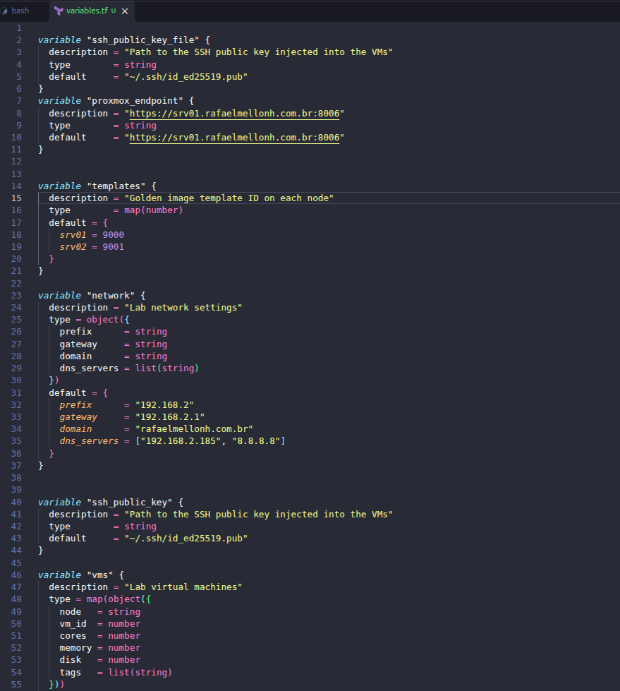
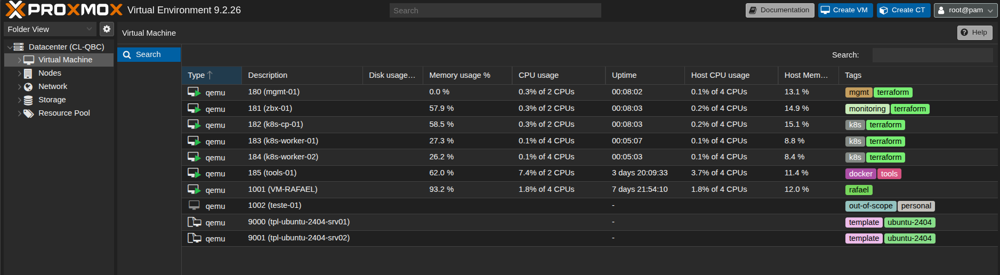
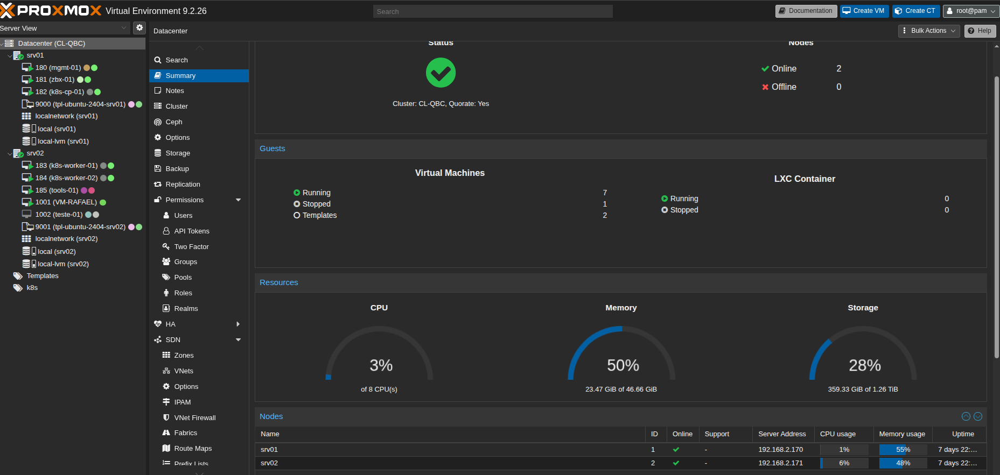

# Phase 4 — Provisioning with Terraform

## 1. Goal

Create the remaining lab VMs as code, from the golden image templates, with Terraform and the
[`bpg/proxmox`](https://github.com/bpg/terraform-provider-proxmox) provider:

| VM | Node | VMID / IP | vCPU | RAM | Disk |
|---|---|---|---|---|---|
| mgmt-01 | srv01 | 180 | 2 | 2 GB | 30 GB |
| zbx-01 | srv01 | 181 | 2 | 4 GB | 50 GB |
| k8s-cp-01 | srv01 | 182 | 2 | 4 GB | 40 GB |
| k8s-worker-01 | srv02 | 183 | 4 | 10 GB | 100 GB |
| k8s-worker-02 | srv02 | 184 | 4 | 10 GB | 100 GB |

`tools-01` stays out of Terraform: it was created by hand in [Phase 3](03-first-vm.md).

Terraform runs from the admin workstation (Ubuntu). The state stays **local** in this phase and moves to
the GitLab HTTP backend in Phase 8, when the pipeline needs it.

## 2. Prerequisites

- [Phase 2](02-golden-image.md): templates `9000` (srv01) and `9001` (srv02)
- [Phase 3](03-first-vm.md): DNS records of all VMs already created in Technitium
- Terraform installed on the workstation (v1.17.2 used here)
- SSH key of the workstation (`~/.ssh/id_ed25519.pub`)

### References

| Topic | Link |
|---|---|
| `bpg/proxmox` provider | https://registry.terraform.io/providers/bpg/proxmox/latest/docs |
| Proxmox user management (`pveum`) | https://pve.proxmox.com/wiki/User_Management |
| Terraform `for_each` | https://developer.hashicorp.com/terraform/language/meta-arguments/for_each |
| Terraform state | https://developer.hashicorp.com/terraform/language/state |

## 3. Step by step

### 3.1 Proxmox user, role and API token

Run on any node (permissions are cluster-wide):

```bash
pveum user add terraform@pve --comment "Terraform - homelab-platform"

pveum role add TerraformProv -privs "Datastore.AllocateSpace Datastore.Audit Pool.Audit SDN.Use Sys.Audit VM.Allocate VM.Audit VM.Clone VM.Config.CDROM VM.Config.CPU VM.Config.Cloudinit VM.Config.Disk VM.Config.HWType VM.Config.Memory VM.Config.Network VM.Config.Options VM.GuestAgent.Audit VM.PowerMgmt"

pveum aclmod / -user terraform@pve -role TerraformProv
pveum user token add terraform@pve provider --privsep 0
```

- A dedicated user with only the privileges Terraform needs, instead of `root@pam`.
- `VM.Monitor` is not in the list: it no longer exists in Proxmox VE 9 (replaced by `VM.GuestAgent.*`).
- `--privsep 0`: the token inherits the user's permissions.
- The token secret is shown **only once**. It is kept in a password manager, never in the repository.

```bash
pveum acl list | grep terraform
pveum user permissions terraform@pve --path /
pveum user token list terraform@pve
```

Expected: one ACL (`/ TerraformProv user terraform@pve`), the 18 privileges of the role and a single token (`provider`).

### 3.2 Token on the workstation

The provider reads the token from the `PROXMOX_VE_API_TOKEN` environment variable, so it never appears in the code.

```bash
mkdir -p ~/.config/homelab
read -rsp "Token secret: " PVE_SECRET; echo
printf "export PROXMOX_VE_API_TOKEN='terraform@pve!provider=%s'\n" "$PVE_SECRET" > ~/.config/homelab/secrets.env
unset PVE_SECRET
chmod 600 ~/.config/homelab/secrets.env
```

In every new terminal, before using Terraform:

```bash
source ~/.config/homelab/secrets.env
```

Token test against the API:

```bash
curl -sk -H "Authorization: PVEAPIToken=${PROXMOX_VE_API_TOKEN}" \
  https://srv01.rafaelmellonh.com.br:8006/api2/json/nodes | jq

curl -sk -H "Authorization: PVEAPIToken=${PROXMOX_VE_API_TOKEN}" \
  "https://srv01.rafaelmellonh.com.br:8006/api2/json/cluster/resources?type=vm" | jq
```

Expected: both nodes, and templates `9000` and `9001` with `"template": 1`.

### 3.3 Code structure

```
terraform/
└── environments/
    └── lab/
        ├── .terraform.lock.hcl   # exact provider version (committed)
        ├── versions.tf
        ├── providers.tf
        ├── variables.tf
        └── main.tf
```

A folder per environment: the cloud phases will add `terraform/environments/cloud/`.

`versions.tf`:

```hcl
terraform {
  required_version = ">= 1.9"

  required_providers {
    proxmox = {
      source  = "bpg/proxmox"
      version = "~> 0.111"
    }
  }
}
```

`providers.tf`:

```hcl
provider "proxmox" {
  endpoint = var.proxmox_endpoint
  insecure = true
}
```

`insecure = true` because the Proxmox certificate is self-signed.

### 3.4 Variables

All the data lives in `variables.tf`; `main.tf` only has the logic.



```hcl
variable "proxmox_endpoint" {
  description = "Proxmox API URL"
  type        = string
  default     = "https://srv01.rafaelmellonh.com.br:8006/"
}

variable "templates" {
  description = "Golden image template ID on each node"
  type        = map(number)
  default = {
    srv01 = 9000
    srv02 = 9001
  }
}

variable "network" {
  description = "Lab network settings"
  type = object({
    prefix      = string
    gateway     = string
    domain      = string
    dns_servers = list(string)
  })
  default = {
    prefix      = "192.168.2"
    gateway     = "192.168.2.1"
    domain      = "rafaelmellonh.com.br"
    dns_servers = ["192.168.2.185", "8.8.8.8"]
  }
}

variable "ssh_public_key_file" {
  description = "Path to the SSH public key injected into the VMs"
  type        = string
  default     = "~/.ssh/id_ed25519.pub"
}

variable "vms" {
  description = "Lab virtual machines"
  type = map(object({
    node   = string
    vm_id  = number
    cores  = number
    memory = number
    disk   = number
    tags   = list(string)
  }))
  default = {
    "mgmt-01"       = { node = "srv01", vm_id = 180, cores = 2, memory = 2048, disk = 30, tags = ["mgmt"] }
    "zbx-01"        = { node = "srv01", vm_id = 181, cores = 2, memory = 4096, disk = 50, tags = ["monitoring"] }
    "k8s-cp-01"     = { node = "srv01", vm_id = 182, cores = 2, memory = 4096, disk = 40, tags = ["k8s"] }
    "k8s-worker-01" = { node = "srv02", vm_id = 183, cores = 4, memory = 10240, disk = 100, tags = ["k8s"] }
    "k8s-worker-02" = { node = "srv02", vm_id = 184, cores = 4, memory = 10240, disk = 100, tags = ["k8s"] }
  }
}
```

- `default` values instead of a `terraform.tfvars`: nothing here is secret, and `*.tfvars` is ignored by Git.
- Adding a VM or changing its size only touches `variables.tf`.

### 3.5 VMs

`main.tf`:

```hcl
data "proxmox_virtual_environment_nodes" "all" {}

output "nodes" {
  value = data.proxmox_virtual_environment_nodes.all.names
}

resource "proxmox_virtual_environment_vm" "vm" {
  for_each = var.vms

  name      = each.key
  node_name = each.value.node
  vm_id     = each.value.vm_id
  tags      = concat(each.value.tags, ["terraform"])

  clone {
    vm_id = var.templates[each.value.node]
    full  = true
  }

  cpu {
    cores = each.value.cores
    type  = "x86-64-v3"
  }

  memory {
    dedicated = each.value.memory
  }

  disk {
    datastore_id = "local-lvm"
    interface    = "scsi0"
    size         = each.value.disk
  }

  agent {
    enabled = true
  }

  initialization {
    ip_config {
      ipv4 {
        address = "${var.network.prefix}.${each.value.vm_id}/24"
        gateway = var.network.gateway
      }
    }

    dns {
      domain  = var.network.domain
      servers = var.network.dns_servers
    }

    user_account {
      username = "rafael"
      keys     = [trimspace(file(var.ssh_public_key_file))]
    }
  }
}
```

- `for_each` creates one VM per entry of `var.vms`, in parallel: `each.key` is the name, `each.value` the data.
- Each VM is cloned from the template **of its own node** (`var.templates[each.value.node]`): storage is local
  to each node, so a VM can only be cloned from a template on the same node.
- The IP follows the rule from Phase 3, **VMID = last octet of the IP**: `192.168.2.180/24` for `mgmt-01`.
- The `data` source and the `nodes` output were the first test of the provider, before any VM existed.

Equivalent of each block in `qm`:

| Block | `qm` equivalent |
|---|---|
| `clone` | `qm clone 9000 180 --full` |
| `cpu` / `memory` | `--cores 2 --memory 2048` |
| `disk` | `qm resize 180 scsi0 30G` |
| `agent` | `--agent enabled=1` |
| `initialization` | `--ipconfig0`, `--nameserver`, `--searchdomain`, `--ciuser`, `--sshkeys` |

### 3.6 Git

`.gitignore` at the root of the repository:

```
.terraform/
*.tfstate
*.tfstate.*
*.tfvars
crash.log
```

- `.terraform.lock.hcl` **is committed**: it pins the exact provider version.
- The state is **never committed**: it can hold sensitive data, changes on every `apply` and has no locking in Git.

### 3.7 Apply

```bash
cd terraform/environments/lab
source ~/.config/homelab/secrets.env
terraform init
terraform fmt
terraform validate
terraform plan
terraform apply
```

Expected plan: `Plan: 5 to add, 0 to change, 0 to destroy`.

The local state is the only record of what Terraform created, so a copy is kept outside the repository:

```bash
mkdir -p ~/backup/homelab
cp terraform.tfstate ~/backup/homelab/terraform.tfstate.$(date +%F)
```

### 3.8 NetBox

The five VMs were changed from `Planned` to `Active` in NetBox (*Virtualization → Virtual Machines*).

## 4. Validation

### Terraform

```bash
terraform state list
terraform plan
```

Five resources (`proxmox_virtual_environment_vm.vm["<name>"]`) and `No changes. Your infrastructure matches the configuration.`

### Proxmox





```bash
qm config 180 | grep -E '^(name|cores|cpu|memory|scsi0|ipconfig0|nameserver|searchdomain|ciuser|agent|tags):'
```

### Inside the VMs (guest agent)

From `srv01`, without SSH keys, through the QEMU guest agent:

```bash
for id in 180 181 182; do
  echo "== VM $id"
  for c in "hostname" "hostname -I" "nproc" "free -h" "df -h /"; do
    qm guest exec $id -- $c | grep out-data
  done
done

ssh srv02 'for id in 183 184; do echo "== VM $id"; for c in "hostname" "hostname -I" "nproc" "free -h" "df -h /"; do qm guest exec $id -- $c | grep out-data; done; done'
```

### SSH from the workstation

```bash
ssh rafael@mgmt-01.rafaelmellonh.com.br
hostname
ip -4 a show eth0
resolvectl status eth0 | grep -E "DNS Servers|DNS Domain"
getent hosts tools-01 ubuntu.com
```

### Summary

| Check | Expected | Result |
|---|---|---|
| Token with only the role privileges | 1 ACL, 18 privileges, 1 token | ✅ |
| Provider reads the nodes | `nodes = ["srv01", "srv02"]` | ✅ |
| VMs created | 5 resources in the state | ✅ |
| Node, VMID, CPU, RAM, disk | as in the table of section 1 | ✅ |
| IP and DNS from cloud-init | `.18x`, Technitium first | ✅ |
| SSH with the workstation key | login as `rafael` | ✅ |
| Tags | role + `terraform` | ✅ |
| Idempotency | `terraform plan` → `No changes` | ✅ |
| State not in Git | `git status` without `*.tfstate` | ✅ |

## 5. Issues found and how they were solved

### `event not found` when exporting the token

**Symptom:** `bash: !provider=: event not found`.

**Cause:** in an interactive shell, `!` triggers history expansion even inside double quotes.

**Solution:** single quotes for the fixed part of the token:
`export PROXMOX_VE_API_TOKEN='terraform@pve!provider='"${PVE_SECRET}"`.

### `Argument names must not be quoted`

**Symptom:** `terraform plan` failed on the line `"${var.network.prefix}.${each.value.vm_id}/24"`.

**Cause:** `address =` was lost while editing, so Terraform read the string as an argument name.

**Solution:** restored `address = "..."`. `terraform validate` catches this kind of error before contacting Proxmox.

### `Reference to undeclared input variable`

**Symptom:** `An input variable with the name "network" has not been declared. Did you mean "networl"?`

**Cause:** typo in the variable name in `variables.tf`.

**Solution:** renamed the variable to `network`.

### `Blocks of type "dns" are not expected here`

**Symptom:** `dns` and `user_account` rejected as unsupported blocks.

**Cause:** an extra `}` closed `initialization` before them.

**Solution:** `dns` and `user_account` moved back inside `initialization`. `terraform fmt` makes this visible
through the indentation.

### `Unable to create Proxmox VE API credentials`

**Symptom:** `must provide either username and password, an API token, or a ticket` in a new terminal.

**Cause:** environment variables only exist in the shell where they were exported.

**Solution:** `source ~/.config/homelab/secrets.env` in every new terminal.

## 6. Future improvements

- Remote state in the GitLab HTTP backend (`terraform init -migrate-state`), required by the pipeline in Phase 8
- `terraform fmt -check`, `validate` and `plan` in GitLab CI; `apply` only from `main`, with manual approval
- Reusable `proxmox-vm` module, shared by the lab and cloud environments
- Valid certificate on the Proxmox API, to remove `insecure = true`
- Token with privilege separation (`--privsep 1`) and its own ACL
- VM list read from NetBox (source of truth) instead of `variables.tf`; NetBox status updated by the pipeline
- DNS records created by Terraform through the Technitium API
