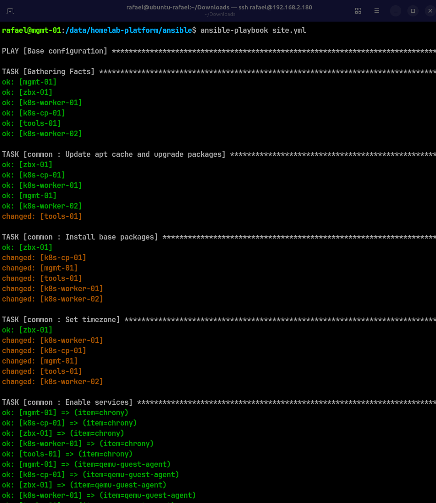

# Phase 5 — Configuration with Ansible

## 1. Goal

Configure every VM created in [Phase 4](04-terraform.md) as code, with Ansible running from `mgmt-01`:

| Role | Hosts | What it does |
|---|---|---|
| `common` | all | Packages, upgrades, timezone, chrony, unattended-upgrades |
| `ssh_hardening` | all | Key-only SSH, no root login |
| `k8s_prereqs` | `k8s` | Swap off, kernel modules, sysctl, containerd, kubeadm/kubelet/kubectl |

The Kubernetes cluster itself (`kubeadm init` / `join`) is created in [Phase 7](07-kubernetes.md).

## 2. Prerequisites

- [Phase 4](04-terraform.md): the five VMs running, with the workstation SSH key injected by cloud-init
- [Phase 3](03-first-vm.md): DNS records of all VMs in Technitium
- Cloud-init user `rafael` with passwordless `sudo` (default for the Proxmox cloud-init user)

### References

| Topic | Link |
|---|---|
| Installing Ansible on Ubuntu | https://docs.ansible.com/ansible/latest/installation_guide/installation_distros.html |
| ansible-lint | https://ansible.readthedocs.io/projects/lint/ |
| Installing kubeadm | https://kubernetes.io/docs/setup/production-environment/tools/kubeadm/install-kubeadm/ |
| Container runtimes (cgroup driver) | https://kubernetes.io/docs/setup/production-environment/container-runtimes/ |
| `sshd_config` | https://man.openbsd.org/sshd_config |

## 3. Step by step

### 3.1 Ansible on mgmt-01

```bash
sudo apt update && sudo apt install -y software-properties-common git pipx
sudo add-apt-repository -y --update ppa:ansible/ansible
sudo apt install -y ansible
pipx install ansible-lint
pipx ensurepath
```

- The official PPA provides a newer `ansible-core` than the Ubuntu repository.
- `ansible-lint` is installed with `pipx` as the normal user (no `sudo`): the Ubuntu package is too old for
  the PPA `ansible-core` (see section 5).

### 3.2 SSH access from mgmt-01

```bash
ssh-keygen -t ed25519 -C "ansible@mgmt-01" -N "" -f ~/.ssh/id_ed25519
```

The VMs only trust the workstation key, so the workstation distributes the mgmt-01 public key:

```bash
KEY=$(ssh rafael@mgmt-01.rafaelmellonh.com.br cat .ssh/id_ed25519.pub)
for h in zbx-01 k8s-cp-01 k8s-worker-01 k8s-worker-02 tools-01; do ssh rafael@$h.rafaelmellonh.com.br "echo '$KEY' >> ~/.ssh/authorized_keys"; done
```

Host keys are recorded on mgmt-01 instead of disabling `host_key_checking`:

```bash
ssh-keyscan -H zbx-01 k8s-cp-01 k8s-worker-01 k8s-worker-02 tools-01 >> ~/.ssh/known_hosts
```

### 3.3 Repository on mgmt-01

The same public key is added to the project as a **deploy key** with write access
(*Settings → Repository → Deploy keys*). A deploy key only grants access to this project, not to the whole account.

```bash
sudo mkdir -p /data && sudo chown rafael:rafael /data
cd /data
git clone git@gitlab.com:rmellonh/homelab-platform.git
cd homelab-platform
git config pull.rebase true
```

`pull.rebase true`: the repository is edited from the workstation and from mgmt-01, so local commits are
replayed on top of the remote ones instead of creating merge commits.

### 3.4 Structure

```
ansible/
├── ansible.cfg
├── requirements.yml
├── site.yml
├── inventories/
│   └── lab/
│       └── hosts.yml
└── roles/
    ├── common/
    ├── ssh_hardening/
    └── k8s_prereqs/
```

All Ansible commands run from `ansible/`, where `ansible.cfg` is read.

### 3.5 Configuration and inventory

`ansible.cfg`:

```ini
[defaults]
inventory = inventories/lab/hosts.yml
remote_user = rafael
interpreter_python = auto_silent
```

`inventories/lab/hosts.yml`:

```yaml
all:
  children:
    mgmt:
      hosts:
        mgmt-01:
          ansible_connection: local
    monitoring:
      hosts:
        zbx-01:
    tools:
      hosts:
        tools-01:
    k8s:
      children:
        k8s_control_plane:
          hosts:
            k8s-cp-01:
        k8s_workers:
          hosts:
            k8s-worker-01:
            k8s-worker-02:
```

- No IP addresses: short names are resolved by Technitium through the search domain set by cloud-init.
- `ansible_connection: local`: mgmt-01 configures itself without SSH.
- `k8s` is a group of groups: plays can target the whole cluster, only the control plane or only the workers.

### 3.6 Collections

`requirements.yml`:

```yaml
collections:
  - name: community.general
  - name: ansible.posix
```

```bash
ansible-galaxy collection install -r requirements.yml --force
```

`--force` installs the collections in `~/.ansible/collections`, which is also visible to the `pipx` ansible-lint.

### 3.7 Role `common`

`roles/common/defaults/main.yml`:

```yaml
common_timezone: America/Toronto

common_packages:
  - vim
  - curl
  - wget
  - git
  - htop
  - jq
  - tree
  - unzip
  - dnsutils
  - bash-completion
  - chrony
  - qemu-guest-agent
  - unattended-upgrades
```

`roles/common/tasks/main.yml`:

```yaml
- name: Update apt cache and upgrade packages
  ansible.builtin.apt:
    update_cache: true
    cache_valid_time: 3600
    upgrade: safe

- name: Install base packages
  ansible.builtin.apt:
    name: "{{ common_packages }}"
    state: present

- name: Set timezone
  community.general.timezone:
    name: "{{ common_timezone }}"

- name: Enable services
  ansible.builtin.service:
    name: "{{ item }}"
    state: started
    enabled: true
  loop:
    - chrony
    - qemu-guest-agent
    - unattended-upgrades

- name: Check if a reboot is required
  ansible.builtin.stat:
    path: /var/run/reboot-required
  register: common_reboot_required

- name: Report reboot required
  ansible.builtin.debug:
    msg: "Reboot required on {{ inventory_hostname }}"
  when: common_reboot_required.stat.exists
```

- `cache_valid_time`: `apt update` only when the cache is older than one hour, so the task stays idempotent.
- The role reports a pending reboot but never reboots: rebooting Kubernetes nodes is a separate decision.

### 3.8 Role `ssh_hardening`

`roles/ssh_hardening/files/10-hardening.conf`:

```
PermitRootLogin no
PasswordAuthentication no
KbdInteractiveAuthentication no
PubkeyAuthentication yes
MaxAuthTries 3
X11Forwarding no
```

`roles/ssh_hardening/tasks/main.yml`:

```yaml
- name: Deploy SSH hardening config
  ansible.builtin.copy:
    src: 10-hardening.conf
    dest: /etc/ssh/sshd_config.d/10-hardening.conf
    owner: root
    group: root
    mode: "0644"
    validate: /usr/sbin/sshd -t -f %s
  notify: Restart ssh
```

`roles/ssh_hardening/handlers/main.yml`:

```yaml
- name: Restart ssh
  ansible.builtin.service:
    name: ssh
    state: restarted
```

- A drop-in file instead of editing `sshd_config`, which a package upgrade can replace.
- `10-` prefix: sshd keeps the **first** value it reads, and drop-ins are read in order, so this file wins over
  `50-cloud-init.conf`.
- `validate`: the file is tested with `sshd -t` before it is put in place, so a syntax error cannot lock out SSH.

### 3.9 Role `k8s_prereqs`

`roles/k8s_prereqs/defaults/main.yml`:

```yaml
k8s_prereqs_modules:
  - overlay
  - br_netfilter

k8s_prereqs_sysctl:
  - net.bridge.bridge-nf-call-iptables
  - net.bridge.bridge-nf-call-ip6tables
  - net.ipv4.ip_forward

k8s_prereqs_version: "1.36"

k8s_prereqs_packages:
  - kubelet
  - kubeadm
  - kubectl
```

`roles/k8s_prereqs/tasks/main.yml`:

```yaml
- name: Disable swap
  ansible.builtin.command: swapoff -a
  when: ansible_facts['swaptotal_mb'] > 0
  changed_when: true

- name: Remove swap entry from fstab
  ansible.builtin.lineinfile:
    path: /etc/fstab
    regexp: '\sswap\s'
    state: absent

- name: Remove swap file
  ansible.builtin.file:
    path: /swap.img
    state: absent

- name: Load kernel modules at boot
  ansible.builtin.copy:
    dest: /etc/modules-load.d/k8s.conf
    content: "{{ k8s_prereqs_modules | join('\n') }}\n"
    owner: root
    group: root
    mode: "0644"

- name: Load kernel modules now
  community.general.modprobe:
    name: "{{ item }}"
    state: present
  loop: "{{ k8s_prereqs_modules }}"

- name: Set sysctl parameters
  ansible.posix.sysctl:
    name: "{{ item }}"
    value: "1"
    sysctl_file: /etc/sysctl.d/k8s.conf
    reload: true
  loop: "{{ k8s_prereqs_sysctl }}"

- name: Install containerd
  ansible.builtin.apt:
    name: containerd
    state: present

- name: Create containerd config directory
  ansible.builtin.file:
    path: /etc/containerd
    state: directory
    owner: root
    group: root
    mode: "0755"

- name: Generate default containerd config
  ansible.builtin.shell: containerd config default > /etc/containerd/config.toml
  args:
    creates: /etc/containerd/config.toml

- name: Enable systemd cgroup driver
  ansible.builtin.lineinfile:
    path: /etc/containerd/config.toml
    regexp: '^\s*SystemdCgroup\s*='
    line: "            SystemdCgroup = true"
    insertafter: 'runtimes\.runc\.options\]$'
  notify: Restart containerd

- name: Enable containerd
  ansible.builtin.service:
    name: containerd
    state: started
    enabled: true

- name: Create apt keyrings directory
  ansible.builtin.file:
    path: /etc/apt/keyrings
    state: directory
    owner: root
    group: root
    mode: "0755"

- name: Add Kubernetes apt key
  ansible.builtin.get_url:
    url: "https://pkgs.k8s.io/core:/stable:/v{{ k8s_prereqs_version }}/deb/Release.key"
    dest: /etc/apt/keyrings/kubernetes.asc
    mode: "0644"

- name: Add Kubernetes apt repository
  ansible.builtin.apt_repository:
    repo: "deb [signed-by=/etc/apt/keyrings/kubernetes.asc] https://pkgs.k8s.io/core:/stable:/v{{ k8s_prereqs_version }}/deb/ /"
    filename: kubernetes
    state: present

- name: Install Kubernetes packages
  ansible.builtin.apt:
    name: "{{ k8s_prereqs_packages }}"
    state: present

- name: Hold Kubernetes packages
  ansible.builtin.dpkg_selections:
    name: "{{ item }}"
    selection: hold
  loop: "{{ k8s_prereqs_packages }}"

- name: Enable kubelet
  ansible.builtin.service:
    name: kubelet
    enabled: true
```

`roles/k8s_prereqs/handlers/main.yml`:

```yaml
- name: Restart containerd
  ansible.builtin.service:
    name: containerd
    state: restarted
```

- **Swap:** the kubelet does not start with swap enabled. Disabled now (`swapoff`) and permanently (`fstab`).
- **Kernel modules and sysctl:** written to files for the next boot and applied immediately.
- **containerd:** from the Ubuntu repository (2.2.x). The cgroup driver must be `systemd`, the same as the kubelet.
  `lineinfile` replaces an existing `SystemdCgroup` line (containerd 1.7) or inserts it under the
  `runc.options` section (containerd 2.x, config version 3).
- **Kubernetes 1.36:** one minor version below the CKA exam environment (1.37), so the cluster upgrade can be
  practiced in Phase 7. The `pkgs.k8s.io` repository is per minor version, and the packages are on hold, so
  neither `apt upgrade` nor unattended-upgrades changes the Kubernetes version.
- **kubelet** is only enabled: it restarts in a loop until `kubeadm init` gives it a configuration. This is expected.

### 3.10 Playbook

`site.yml`:

```yaml
- name: Base configuration
  hosts: all
  become: true
  roles:
    - role: common
      tags: common
    - role: ssh_hardening
      tags: ssh_hardening

- name: Kubernetes prerequisites
  hosts: k8s
  become: true
  roles:
    - role: k8s_prereqs
      tags: k8s_prereqs
```

Tags allow running a single role while developing it:

```bash
ansible-playbook site.yml --limit k8s-cp-01 --tags k8s_prereqs
```

### 3.11 Run

```bash
ansible-lint
ansible-playbook site.yml --syntax-check
ansible-playbook site.yml --limit zbx-01
ansible-playbook site.yml
```

Each role was tested on one host (`--limit`) before being applied to all of them.



## 4. Validation

### Connectivity

```bash
ansible-inventory --graph
ansible all -m ping
ansible all -b -m command -a whoami
```

### Idempotency

```bash
ansible-playbook site.yml
```

Second run: `changed=0` on all six hosts.

### common

```bash
ansible all -m command -a "timedatectl show -p Timezone --value"
ansible all -m command -a "chronyc tracking" | grep -E "SUCCESS|CHANGED|Leap"
```

### ssh_hardening

From the workstation:

```bash
ssh rafael@zbx-01.rafaelmellonh.com.br hostname
ssh -o PubkeyAuthentication=no rafael@zbx-01.rafaelmellonh.com.br
ssh root@zbx-01.rafaelmellonh.com.br
```

Effective configuration on all hosts:

```bash
ansible all -b -m shell -a "sshd -T | grep -E '^(permitrootlogin|passwordauthentication|maxauthtries|x11forwarding) '"
```

### k8s_prereqs

```bash
ansible k8s -m shell -a "free -h | grep Swap; lsmod | grep -E 'overlay|br_netfilter'; sysctl net.ipv4.ip_forward"
ansible k8s -b -m shell -a "systemctl is-active containerd; containerd config dump | grep SystemdCgroup"
ansible k8s -b -m shell -a "kubeadm version -o short; kubectl version --client | head -1; apt-mark showhold"
```

`containerd config dump` shows the configuration containerd actually loaded, not just the file.

### Summary

| Check | Expected | Result |
|---|---|---|
| Inventory | 4 groups, 6 hosts | ✅ |
| SSH from mgmt-01 + sudo | `pong` and `root` on all hosts | ✅ |
| Lint | `Passed` (profile `production`) | ✅ |
| Timezone / chrony | `America/Toronto`, `Leap status: Normal` | ✅ |
| SSH key login | works | ✅ |
| Password and root login | `Permission denied` | ✅ |
| Swap | `0B` | ✅ |
| Kernel modules / sysctl | loaded / `= 1` | ✅ |
| containerd | `active`, `SystemdCgroup = true` | ✅ |
| Kubernetes packages | `v1.36.x`, on hold | ✅ |
| Idempotency | `changed=0` on the second run | ✅ |

## 5. Issues found and how they were solved

### `Host key verification failed`

**Symptom:** every host `UNREACHABLE` except mgmt-01.

**Cause:** the `known_hosts` of mgmt-01 was empty, and Ansible cannot answer the `yes` prompt.

**Solution:** `ssh-keyscan` with the same short names used in the inventory. Disabling `host_key_checking` would
also work, but it removes the protection against man-in-the-middle attacks.

### `ansible-lint`: `No module named 'ansible.parsing.yaml.constructor'`

**Cause:** the `ansible-lint` package from Ubuntu 24.04 is older than the `ansible-core` from the PPA.

**Solution:** removed the apt package and installed it with `pipx`. A first attempt with `sudo pipx` installed it
for root (`/root/.local/bin`), outside the user's `PATH`: `pipx` must run as the normal user.

### `couldn't resolve module/action 'community.general.timezone'`

**Cause:** the `pipx` ansible-lint uses its own isolated `ansible-core` and does not see the collections bundled
with the PPA package. `ansible-galaxy` reported `Nothing to do` because it found the bundled copy.

**Solution:** `requirements.yml` in the repository and `ansible-galaxy collection install -r requirements.yml --force`,
which installs into `~/.ansible/collections`.

### `validate` failed: `No such file or directory: /usr/bin/sshd`

**Cause:** typo in the path; `sshd` lives in `/usr/sbin`.

**Solution:** fixed the path. The validation failed before the file was written, so the SSH configuration was never touched.

### `modprobe: FATAL: Module br_netfiler not found`

**Cause:** typo in the module name in `defaults/main.yml`.

**Solution:** fixed the variable. Since the list lives in a single place, the next run also rewrote `/etc/modules-load.d/k8s.conf`.

### Reboot hung, and VMs stopped resolving internal names

**Symptom:** `ansible all -m reboot` never returned, although the VMs were up.

**Cause:** while `tools-01` (Technitium) rebooted, `systemd-resolved` switched to the secondary DNS `8.8.8.8` and
stayed there. The public DNS answers `NXDOMAIN` for the lab names, which is a valid answer, so it never went
back to Technitium.

**Solution:** `ansible all -b -m service -a "name=systemd-resolved state=restarted"`. In the future,
`tools-01` is rebooted separately from the other VMs (see section 6).

### containerd: `SystemdCgroup` not applied, with `changed=0`

**Cause:** Ubuntu installed containerd 2.2. Its default configuration (version 3) has no `SystemdCgroup = false`
line, so the original `replace` task found nothing and reported `ok`.

**Solution:** `lineinfile` that replaces the line if it exists or inserts it under `runtimes.runc.options`.
Lesson: idempotency does not prove correctness. The problem was only visible by checking the result.

### `INJECT_FACTS_AS_VARS` deprecation warning

**Cause:** `ansible_swaptotal_mb` (facts as top-level variables) will be removed in ansible-core 2.24.

**Solution:** `ansible_facts['swaptotal_mb']`.

### `git push` rejected

**Cause:** commits pushed from the workstation while working on mgmt-01.

**Solution:** `git config pull.rebase true`, then `git pull` and `git push`.

## 6. Future improvements

- Second DNS server with a secondary zone on the other Proxmox node, replacing `8.8.8.8` as fallback
- SSH authorized keys managed by Ansible (`ansible.posix.authorized_key`) instead of the manual distribution
- Collection versions pinned in `requirements.yml`
- `ansible-lint` and `--syntax-check` in GitLab CI (Phase 8)
- Ansible Vault for secrets, when a role needs one
- Inventory read from NetBox (dynamic inventory)
- `.bashrc` and MOTD managed by the `common` role
- Rolling reboots (`serial: 1`) for Kubernetes nodes
- Kubernetes upgrade path in the role (repository per minor version, unhold/hold), in Phase 7
